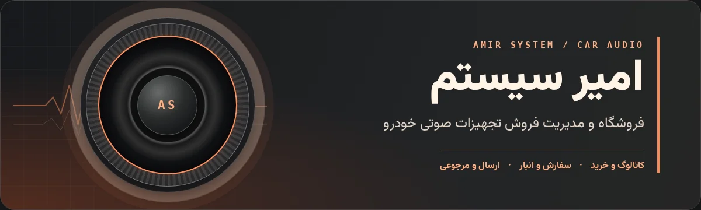
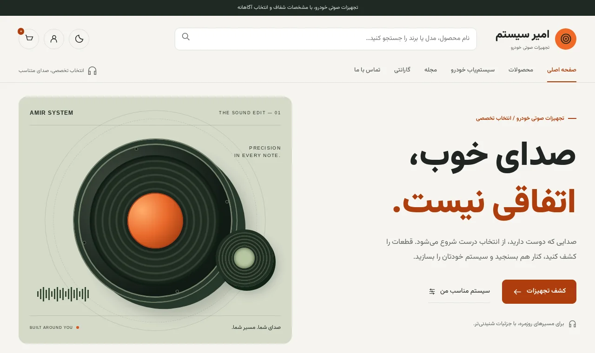
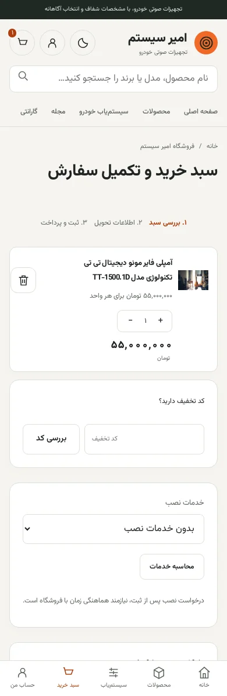
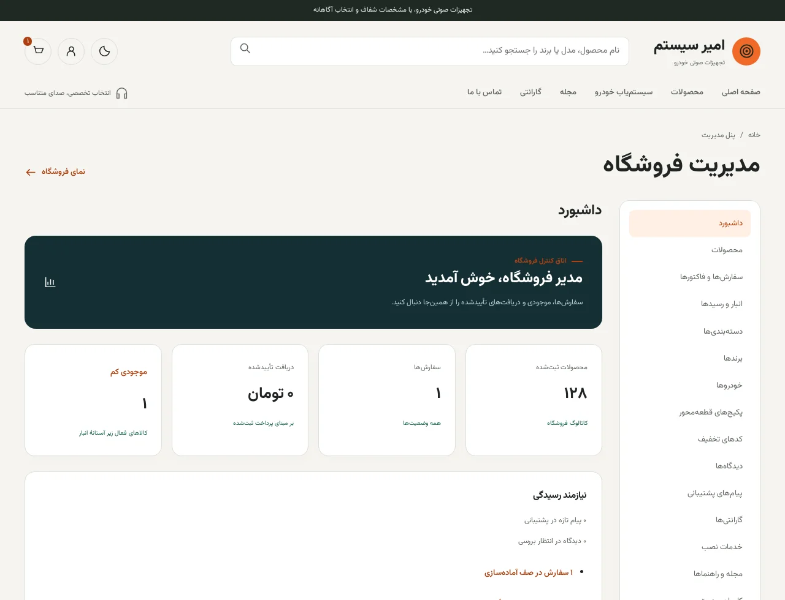
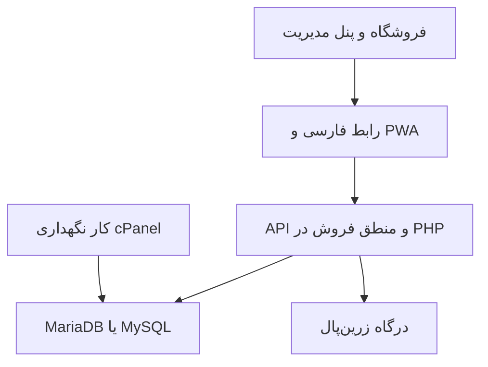

<div align="center">



<h1>امیر سیستم | Amir System</h1>
<p><strong>تجهیزات صوتی خودرو را پیدا و مقایسه کنید. سفارش را تا تحویل، از همان فروشگاه دنبال کنید.</strong></p>

<p>
  <a href="#preview">نمای فروشگاه</a> ·
  <a href="#features">قابلیت‌ها</a> ·
  <a href="#quick-start">شروع سریع</a> ·
  <a href="#architecture">معماری</a> ·
  <a href="#guides">راهنماها</a> ·
  <a href="#english">English</a>
</p>

<p>
  
  
  
  
  
</p>

</div>

---

**امیر سیستم** یک فروشگاه فارسی تجهیزات صوتی خودرو و پنل عملیاتی فروش است. خریدار می‌تواند کالا را بر اساس بودجه، برند و خودرو بررسی کند و از سبد به فاکتور و رهگیری برسد. مدیر فروشگاه از همان سامانه پرداخت، موجودی، ارسال و مرجوعی را پیگیری می‌کند.

<a id="preview"></a>
## یک نگاه به امیر سیستم

<div align="center">
  
  <p><sub>تصاویر از رابط واقعی برنامه در اجرای محلی با دادهٔ نمونه تهیه شده‌اند.</sub></p>
</div>

<table>
  <tr>
    <td width="34%" align="center" valign="top">
      <h3>سبد خرید روی موبایل</h3>
      
      <p>تعداد کالا، تخفیف، هزینهٔ ارسال و مبلغ نهایی قبل از ثبت سفارش در دسترس‌اند.</p>
    </td>
    <td width="66%" align="center" valign="top">
      <h3>داشبورد مدیریت فروش</h3>
      
      <p>سفارش‌های آماده‌سازی، پرداخت‌های نیازمند بررسی و کالاهای کم‌موجود را از داشبورد باز کنید.</p>
    </td>
  </tr>
</table>

<a id="features"></a>
## قابلیت‌ها

<table>
  <tr>
    <td width="50%" valign="top">
      <h3>🔊 کاتالوگ تجهیزات صوتی</h3>
      <p>جست‌وجو، فیلتر قیمت و برند، مقایسهٔ قطعات و پیشنهاد اولیه بر اساس خودرو و بودجه. سازگاری نهایی پیش از نصب بررسی می‌شود.</p>
    </td>
    <td width="50%" valign="top">
      <h3>🛒 سبد، سفارش و پرداخت</h3>
      <p>خرید مهمان یا از طریق حساب، کوپن و خدمات نصب. رزرو موجودی، بازیابی سفارش پس از قطع پاسخ و رسیدگی به دریافت نامشخص.</p>
    </td>
  </tr>
  <tr>
    <td valign="top">
      <h3>📦 موجودی و گردش انبار</h3>
      <p>موجودی قابل‌فروش و رزروشده، SKU، محل قفسه و آستانهٔ کمبود برای هر کالا. ثبت ورود، خروج و اصلاح شمارش همراه با سابقه.</p>
    </td>
    <td valign="top">
      <h3>🚚 ارسال، تحویل و مرجوعی</h3>
      <p>لیست برداشت، برچسب ارسال، کد رهگیری و ثبت تحویل ناموفق یا ارسال مجدد. دریافت و بازپرداخت مرجوعی در سطح هر قلم.</p>
    </td>
  </tr>
  <tr>
    <td valign="top">
      <h3>📊 گزارش و نظارت</h3>
      <p>گزارش دریافت و بازپرداخت بر اساس بازهٔ زمانی و روش پرداخت، خروجی CSV، سوابق تغییرات و کنترل سلامت انبار و اسناد مالی.</p>
    </td>
    <td valign="top">
      <h3>📱 تجربهٔ فارسی روی موبایل</h3>
      <p>رابط راست‌چین، وزیرمتن، تم روشن و تیره، خط زمانی سفارش و امکان نصب به‌عنوان PWA. ثبت سفارش و عملیات پنل به سرور متصل هستند.</p>
    </td>
  </tr>
</table>

### مسیر یک سفارش

| مرحله | خریدار | فروشگاه |
| --- | --- | --- |
| انتخاب | کالا و افزودنی‌ها را بررسی می‌کند | قیمت، موجودی و شرایط فروش را تنظیم می‌کند |
| ثبت | مبلغ نهایی و روش پرداخت را می‌بیند | مبلغ را در سرور محاسبه و موجودی را رزرو می‌کند |
| آماده‌سازی | وضعیت سفارش را می‌بیند | وجه را بررسی و لیست برداشت را آماده می‌کند |
| ارسال و تحویل | کد رهگیری و زمان تحویل را می‌بیند | مرسوله را ثبت و مشکلات حمل را پیگیری می‌کند |
| مرجوعی | موضوع را با فروشگاه پیگیری می‌کند | دریافت کالا و بازپرداخت را ثبت و موجودی سالم را برمی‌گرداند |

<a id="quick-start"></a>
## راه‌اندازی سریع روی cPanel

**پیش‌نیازها** PHP 8.2+ با `pdo_mysql`، `mbstring`، `curl` و `openssl`، یکی از MariaDB 10.6+ یا MySQL 8.0.21+ و دامنه با HTTPS.

1. مخزن را دریافت کنید. برای نصب تازه، [ساختار](database/01_schema.sql) و سپس [کاتالوگ اولیه](database/02_catalog.sql) را در دیتابیس خالی وارد کنید.
2. ریشهٔ وب را روی `public/` بگذارید. پوشه‌های `php/` و `database/` و فایل `.env` یک سطح بالاتر از ریشهٔ وب قرار می‌گیرند. برای تنظیم اتصال دیتابیس و `APP_URL` از [قالب تنظیمات](.env.example) استفاده کنید.
3. مدیر اولیه را در `/setup` ایجاد کنید و سپس کلید نصب را از `.env` پاک کنید. از `/admin` تنظیمات فروش را انجام دهید.
4. [کار نگهداری](php/maintenance.php) را مطابق راهنما در Cron ثبت و وضعیت نصب را با `/healthz` و صفحهٔ سلامت پنل بررسی کنید.

<details>
<summary><strong>ارتقای دیتابیس موجود به ساختار ۶</strong></summary>

ابتدا از فایل‌ها و دیتابیس پشتیبان بگیرید و نسخهٔ فعلی را از مقدار `schema_version` در جدول `settings` بخوانید. اسکریپت‌ها را از همان نسخه به بعد، به‌ترتیب اجرا کنید.

| از → به | اسکریپت |
| --- | --- |
| ۲ → ۳ | [05_upgrade_2_to_3.sql](database/05_upgrade_2_to_3.sql) |
| ۳ → ۴ | [06_upgrade_3_to_4.sql](database/06_upgrade_3_to_4.sql) |
| ۴ → ۵ | [07_upgrade_4_to_5.sql](database/07_upgrade_4_to_5.sql) |
| ۵ → ۶ | [08_upgrade_5_to_6.sql](database/08_upgrade_5_to_6.sql) |

کاتالوگ اولیه مخصوص نصب تازه است. برای زمان توقف سفارش‌گیری و انتقال فایل‌ها، [راهنمای کامل cPanel](INSTALL-CPANEL.fa.md) را ببینید.

</details>

<a id="architecture"></a>
## معماری



| لایه | مسئولیت |
| --- | --- |
| [رابط وب](public/) | نمایش محصولات، سبد، حساب، فاکتور و پنل مدیریت |
| [بک‌اند PHP](php/) | احراز هویت، قیمت نهایی، تراکنش‌های سفارش، درگاه و گزارش‌گیری |
| [دیتابیس](database/) | کاتالوگ، سفارش، رزرو، گردش انبار و اسناد مالی |
| [آزمون‌ها](tests/) | پذیرش، قرارداد API، سلامت داده، امنیت HTTP و هم‌زمانی خرید |

<a id="guides"></a>
## راهنماها و آزمون‌ها

| کار | مرجع |
| --- | --- |
| نصب روی هاست یا مهاجرت اطلاعات | [راهنمای cPanel](INSTALL-CPANEL.fa.md) |
| مرور تغییرات نسخه | [تاریخچهٔ شاخهٔ اصلی](https://github.com/erfand39/amir-system/commits/main/) |
| بررسی ساختار و یکپارچگی | [اسکریپت بررسی سلامت](database/03_health.sql) · [سورس آزمون‌ها](tests/) |
| گزارش خطا یا پیشنهاد | [Issues](https://github.com/erfand39/amir-system/issues) |

<details>
<summary><strong>اجرای آزمون‌های محلی</strong></summary>

PHP 8.2+ با `pdo_sqlite` و `mbstring` و Python 3 برای آزمون‌های HTTP لازم است. دستورها را از ریشهٔ مخزن اجرا کنید.

```sh
php tests/php-workflow.php
php tests/php-acceptance.php
php tests/php-contract.php
php tests/php-health.php
php tests/php-security.php
python3 tests/http-workflow.py
python3 tests/http-security.py
```

گردش کار و مهاجرت دیتابیس تا ساختار ۶ روی MariaDB آزمایش شده‌اند. آزمون‌های درگاه از پاسخ شبیه‌سازی‌شده استفاده می‌کنند. روی دامنهٔ مقصد، یک تراکنش کنترل‌شده و بازگشت از درگاه را بررسی کنید.

</details>

---

<a id="english"></a>
## English

**Amir System** is a Persian-first car-audio storefront and operations panel. It includes product comparison, guest checkout, stock reservations, payment review, shipping and tracking, item-level returns, and CSV finance reports.

It runs on PHP 8.2+ with MariaDB or MySQL. For cPanel deployment, use `public/` as the document root and keep application code, configuration, and database files outside it. The current database schema is **6**.

[Deployment and upgrade guide (Persian)](INSTALL-CPANEL.fa.md) · [Database scripts](database/) · [Tests](tests/)
